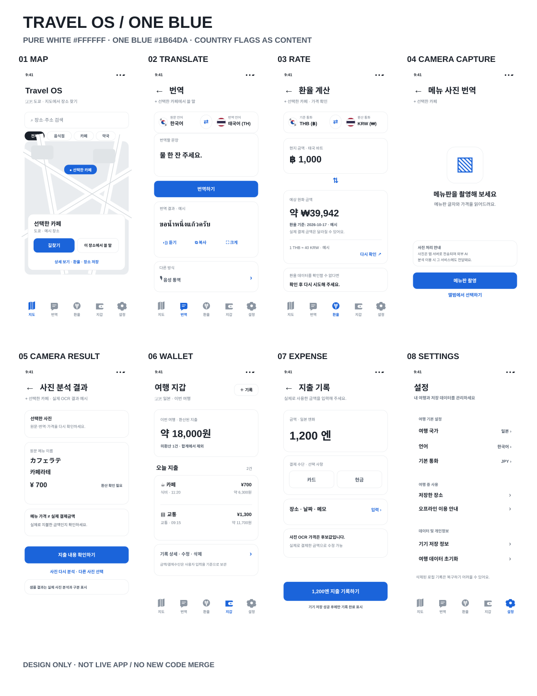

# Travel OS · CURRENT DESIGN — One Blue + Neutral · A03 implementation handoff

> **발신 A03 (디자인·UX Writing) → 수신 A02 (개발), A01 (오너)**  
> **상태:** `DESIGN_REPLACED / MONOCHROME_THEME_NOT_APPLIED / DEVICE_QA_NOT_TESTED`  
> **기준 코드:** Track B [PR #11](https://github.com/Junebooky/travel-os/pull/11) HEAD `277e9b97b0a8848db99318b76c8c4a4e17ec47a3` (owner screenshot local checkout SHA not independently checked) (당시 open/unmerged).  
> **의미:** 아래 이미지는 **디자인 목적의 SVG 목업**이며 실제 실행 화면/QA 스크린샷이 아닙니다. 이미지 속 금액·장소·환율 기준일은 시각 설명을 위한 **가상 예시**입니다.

## ⚠ A02 필독 — 오너 실화면 대비 구현 프롬프트

**오너가 제시한 실제 localhost 화면은 아직 본 디자인과 다릅니다.** 다크 배경·보라·노랑·초록 UI가 남아 있고, 번역 언어와 결과의 정합성 및 지출 결제 수단 기본값도 점검이 필요합니다.

➡️ **[A02_IMPLEMENTATION_PROMPT — 실제 화면 6종 Before/After + 소스 코드 위치 + 구현 프롬프트 + 완료 체크](./A02-IMPLEMENTATION-PROMPT.md)**

**현재 단일 시각 정본:** 아래 8개 SVG + 전체 스토리보드(실제 스크린샷 아님). A02는 위 프롬프트와 SVG를 읽고 **PR #11의 실제 React/Tailwind 코드**를 수정합니다. 디자인 PR #18 문서 갱신만으로 UI 구현 완료 처리하면 안 됩니다.

---

## 0. [오너 운영 규칙] 디자인 변경 시 GitHub **현재본 교체·구본 제거** — 반드시 준수

**오너 지시(2026-10-18):** 디자인은 지속 변경 가능. **바뀐 페이지는 즉시 GitHub에 업데이트하고 이전 버전의 이미지/파일은 최신 파일 목록에서 삭제**한다. 본 문서는 **A03의 현재 디자인 단일 정본(SINGLE_SOURCE_OF_TRUTH)**이다.

1. **기존 파일 경로 그대로 overwrite:** 페이지 변경 시 아래 고정 경로의 SVG를 `fetch_file` → 해당 blob SHA 사용한 `update_file`로 **내용 전체 교체**한다. `01-map-old.svg`, `01-map-v4.svg`, `final-final.svg`처럼 구형·중복 파일을 쌓지 않는다. 기존 경로를 유지해야 #15/PR #11의 링크가 계속 최신 시안으로 연결된다.
2. **연결 파일 같은 변경 묶음 처리:** 한 페이지라도 바뀌면 **해당 개별 SVG + `white-ui-v3-overview.svg`(8면 스토리보드) + 본 `README.md`의 시안 상태/카피/Before·After/수용 기준**을 같은 작업 턴에서 동기화한다. 구형 설명이 남지 않도록 README 변경 사항을 먼저 확인한다.
3. **안 쓰는 디자인은 HEAD에서 실제 삭제:** 사라진 페이지/대체된 이미지가 있다면 GitHub `delete_file`로 그 자산을 **현재 디자인 브랜치의 최신 트리에서 제거**한다. README/스토리보드 링크 및 #15/PR #11 참조도 최신 파일로 수정한다. **교체물이 정상 업로드되기 전에 유일한 현행 파일을 먼저 삭제하지 않는다.**
4. **A02 즉시 직접 인계:** 이미지 갱신 커밋의 전체 SHA, 바뀐 화면 ID, 달라진 UI/상태/카피 키, A02에서 건드릴 컴포넌트, 완료 판정을 #15와 PR #11에 `[A03 → A02]`로 게시한다. #13의 A03 체크도 갱신한다. **GitHub 댓글이 다른 대화 런타임을 자동 실행하진 않으므로** A02는 매 작업 전에 본 문서/PR #18을 읽어야 한다.
5. **검증 후 완료 판정:** `fetch_file`로 갱신 경로/올바른 SVG 및 현재 이미지 개수, `get_pr_info`/changed filenames로 PR #18 상태 확인. SVG 변경은 **DESIGN_UPDATED**, A02 개발 변경은 **CODE_APPLIED**, CI/브라우저/실기기 검증은 **별도**로 구별한다.
6. **삭제의 정확한 의미:** 오래된 **이미지·불필요한 시안 파일은 최신 브랜치에서 제거**한다. Git 커밋 기록/오너 의사결정 및 이전 이슈 코멘트는 과거 증거로 남을 수 있고, 기록 전체를 파괴적으로 지우지는 않는다. 이전 버전 댓글에는 **SUPERSEDED / 현재 정본 링크**를 표시해 혼동을 막는다.

**현재 화면 파일 경로(항상 해당 파일의 최신 내용):**

| ID | 현재 편집 대상 | 변경 시 함께 확인할 코드 |
|---|---|---|
| MAP | `images/01-map.svg` | `MapView.tsx`, `Navigation.tsx` |
| TRANSLATE | `images/02-translate.svg` | `TranslateView.tsx` |
| RATE | `images/03-rate.svg` | `CurrencyView.tsx` |
| CAMERA_CAPTURE | `images/04-camera-capture.svg` | `CameraMenuModal.tsx` |
| CAMERA_RESULT | `images/05-camera-result.svg` | `CameraMenuModal.tsx` |
| WALLET | `images/06-wallet.svg` | `WalletView.tsx` |
| EXPENSE | `images/07-expense.svg` | `WalletView.tsx`, `TravelContext.tsx` |

**변경 현황 · 2026-10-18 KST:** 오너의 **단일 브랜드 블루·무채색만** 규칙에 따라 기존 화면 01~07 SVG를 **동일 경로에서 전부 덮어썼고**, 기존 스토리보드도 교체했습니다. 누락된 핵심 탭 **08 설정**을 추가해 현재 **8개 개별 SVG + 1개 overview**가 정본입니다. v2/이전 v3의 연한 블루, 황색·주황색 등 구형 색상은 현재 파일에서 제거했으며, 불필요한 별도 중복 파일은 없습니다. 과거 커밋의 디자인은 기록만 남습니다.

**개발과 구분:** A02는 이미 PR #11 SHA `277e9b97b0a8848db99318b76c8c4a4e17ec47a3`에서 P0 저장 진실성·OCR 지출 확인·핀 접근성 등 일부를 수정하고 [CI #39046026882](https://github.com/Junebooky/travel-os/actions/runs/39046026882)를 통과했다고 #15에 보고. 이는 **화이트 테마 전체 적용 완료와 다르며**, A03 시안 교체 여부와도 별도이다. A03는 A02 새 SHA에 맞춰 중복 개발 지시를 제거하며, 업데이트된 디자인만 정본으로 유지한다.

---

## A. 먼저 이미지로 전체 맥락 확인



| 번호 | 화면 이미지 | 개발 위치 | 반드시 동작해야 하는 것 |
|---|---|---|---|
| 01 | [지도 홈](./images/01-map.svg) | `src/components/MapView.tsx`, `Navigation.tsx` | 선택 장소 → 길찾기/상황별 번역. 시트 peek/expanded/지도 맥락·safe-area 보존 |
| 02 | [번역](./images/02-translate.svg) | `src/components/TranslateView.tsx` | **← 지도 복귀**는 독립 버튼. 장소명은 보조 텍스트. 실패 원문을 번역 성공처럼 표시 금지 |
| 03 | [환율](./images/03-rate.svg) | `src/components/CurrencyView.tsx` | 신뢰 가능한 캐시에서만 환산, 공급자·날짜·stale 인라인, 재시도는 인접 |
| 04 | [메뉴 사진 촬영 단계](./images/04-camera-capture.svg) | `src/components/CameraMenuModal.tsx` | 촬영·앨범 선택에 집중. 사진 서버/외부 AI 전송 사실은 업로드 **전에** 고지 |
| 05 | [사진 분석 결과 단계](./images/05-camera-result.svg) | `CameraMenuModal.tsx` | 원문/번역/가격 검토 후 **지출 내용 확인하기**. 실패 후 같은 사진 재분석 |
| 06 | [여행 지갑](./images/06-wallet.svg) | `src/components/WalletView.tsx` | 상단 `+ 기록`; 금액→날짜별 내역 연속. 미환산 N건은 요약에 바로 가시화 |
| 07 | [지출 입력](./images/07-expense.svg) | `WalletView.tsx`, `src/context/TravelContext.tsx` | OCR 후보/수동 금액 수정 → 최종 버튼 → **기기 저장 확인** 후에만 합계 반영 |
| 08 | [설정](./images/08-settings.svg) | `SettingsView.tsx` | 여행 기본 설정·저장 장소·오프라인 이용·데이터 삭제를 명확히 분리 |

개발자가 이 문서/이미지를 복사해 실행 가능한 앱으로 오해하지 않도록 **화면 스타일 명세와 실제 수용 동작을 분리**했습니다.

## B. 오너 확정: **브랜드 블루 단 1색, 나머지 무채색** (CURRENT)

**2026-10-18 오너의 최신 수정:** 브랜드 컬러를 연하게 희석해 별도 틴트/표면으로 사용하지 않으며, 주황·노랑·초록·빨강·보라 등 엉뚱한 보조 브랜드색을 도입하지 않는다. 이전 v2/v3에 있던 `#3182F6`(추가 블루), `#E8F3FF`(파스텔 블루 카드), `#7B561D`(갈색/주황 경고), 녹색 지도 일러스트는 **더 이상 최신 이미지/구현 목표가 아니다**.

| 의미 토큰 | 최종 색상 | 적용 방식 |
|---|---|---|
| `--os-page` | `#F2F4F6` | 화면 바탕, 선택되지 않은 중립 버튼 |
| `--os-surface` | `#FFFFFF` | 헤더, 카드, 하단 5탭 |
| `--os-text` | `#191F28` | 제목, 지출 금액, 버튼 보조 강조 |
| `--os-text-secondary` | `#4E5968` | 장소, 날짜, 환율 출처, 오류/주의 안내 |
| `--os-text-muted` | `#6B7684`, `#8B95A1` | 비강조 정보/비선택 아이콘(대비 확인) |
| `--os-brand` | **`#1B64DA` 단 1색** | 주 CTA 배경, 현재 선택된 하단 탭, 지도 선택 핀 및 필수 focus ring |
| `--os-divider` | `#E5E8EB` | 구획 경계가 꼭 필요할 때만 |
| **지도 시안 중립 영역** | `#E9ECEF`, `#E0E4E7`, `#D1D6DA` | 시안 속 예시 지도 일러스트에만 사용 |

### 사용 금지
- 블루에 불투명도를 줘서 `blue/10`, `blue/20`, `rgba(brand, .1)`, `#E8F3FF` 같은 배경이나 서브 브랜드 컬러 생성 **금지**.
- 경고를 표현한다고 주황·앰버·빨강을 임의 추가 **금지**. 메시지 문구, 텍스트 강약, 정보/경고 아이콘, 그룹 간격으로 구분. 위험 작업(삭제)은 **명확한 대화상자와 '삭제' 레이블**로 구별한다.
- 여러 메인 블루(예: `#3182F6`와 `#1B64DA`) 혼용 금지. hover/pressed 시에도 다른 푸른 색조로 바꾸지 말고 대비·명도·규모/레이어 변화를 비색상 방식으로 설계(권장: 눌림/outline/투명도 아닌 크기/그림자 등; WCAG 포커스 유지).
- 실제 OSM 지도 타일에 **컬러 금지 규칙을 기계적으로 적용해 정보를 파괴하지 않는다.** 시안 속 지도 일러스트는 회색이지만 실제 지도는 도로/공원/물길 판독 가능성과 원본 타일 저작권 고지를 유지한다. 앱 UI 크롬/컴포넌트에만 팔레트 제한.
- 카메라 프라이버시·유효하지 않은 환율·지갑 부분 합계의 **필수 사실 고지 숨김 금지**. 색 없는 오류/경고도 사용자가 구별 가능해야 함.

### UI 원칙
- 서피스는 `#F2F4F6` 대 `#FFFFFF` 면으로 구분하고 일반 카드 테두리 제거. 입력 폼·키보드 포커스와 필수 오류의 식별 경계는 유지.
- 브랜드 블루는 주행동에만 강하게, 주변은 대부분 검은 텍스트/회색·화이트. 두 번째 버튼은 **회색 배경 + 진한 검정 텍스트**(희석 블루 배경·서브 블루 텍스트 없음).
- 디자인의 상단 독립 ←/타이틀/장소명, 하단 5탭 일관된 채움형 아이콘은 유지. 카드 radius 16~20px, 간격 8/12/16/24px, 터치 영역 44px 이상, 본문 14~16px, 중요 고지 14px 이상.
- 320/375/430px·200% 확대·safe area·키보드 대응. 상태는 색상 단독 신호 불가. 중요한 본문 최소 대비 4.5:1과 실제 화면 실측 요구.
- 이전 코드의 `globals.css #020617`, Slate 900/950, OSM 반전 필터는 **AS_IS**. 최신 밝은 UI/브랜드 단색은 **TO_BE**이고 A02 새 렌더링 검증 전 `IMPLEMENTED`라고 주장하지 않는다.

## C. 스크린별 실구현 행동 계약

### C-01. 지도
**현 구현 재사용:** peek/expanded sheet, 두 가지 첫 CTA(길찾기/장소 번역), 저장/가격/메뉴 사진, 선택 핀 상태, 유효 데모 라벨, 확대축소/내 위치. 중복 구현 금지.  
**변경:** 카드/검색/하단 탭 라이트 토큰; 핀 접근 가능한 `button`/키보드; `returnToMapWithPlace` 사용 맥락에 따라 **원래 지도 중심·줌·선택** 복귀 vs 저장 장소 지정 이동 의도 분리(#17 D-P0-01).  
**수용:** 320·375·430px, safe-area/모바일 키보드/시트 겹침 없음, Tab/Enter/Space로 핀 선택, 검색 오류/0건 분기.

### C-02. 번역
**변경:** 상단 `←` 44px 독립 버튼 + 제목 아래 `선택한 장소` 정보. 번역 결과 큰 텍스트.  
**유지:** 실제 API/검증된 로컬 문구가 번역에 성공하기 전 TTS/성공 표시 금지. 실패 시 원문 유지, 재시도 버튼. 장소 없을 때 가짜 컨텍스트 붙이지 않음.

### C-03. 환율
**의도:** '부분 실패'는 **이미 검증된 캐시가 있을 때** 가능한 폴백이지, **임의 기본 환율을 만드는 기능이 아닙니다.**
- 정상 응답 & 유효 데이터 → 예상 KRW + 실제 제공처·기준일.
- API 실패 & **검증된 7일 이내 캐시** → 지난 환율로 계산한 금액 + 기준일·공급자·'지난 환율' + 카드 내부 인라인 재시도.
- 캐시 없음/7일 초과/메타데이터 무효 → **예상 금액 미산정**(0원·1:1·추정 기본환율 금지) + '환율 확인이 필요해요' + 바로 옆 재시도.
- **이미 존재:** `getValidatedCachedRates` 7일 유효성, `isStale`, `currency.rate.stale_body`, `currency.result.as_of/source` 재사용.
- **기존 이슈:** #17 D-P1-01('이전에 받은 환율'과 실제 캐시 없음)과 중복 수정 금지.

### C-04. 카메라 → C-05. 결과
```text
CAPTURE_EMPTY
  → 촬영/갤러리 선택(고지 선행)
  → PRIVACY_TRANSMIT_NOTICE / 분석 동의(실제 처리 흐름에 맞게)
  → UPLOADING/ANALYZING
  ├→ REAL_RESULT : 원문·번역·가격 후보, 실제 사진 출처 표기
  ├→ OCR_ERROR   : 같은 이미지 유지·사진 다시 분석 / 다른 사진 선택
  └→ DEMO_RESULT : 샘플 데이터 명시, 실제 사진 결과나 지출로 오인 금지
REAL_RESULT → REVIEW_ACTUAL_EXPENSE → SAVE → WALLET
```
- **금지:** 이미지를 선택한 즉시 고지 없이 제3자 전송, 촬영 전 결과 프리뷰, 분석 실패한 실사진을 임의 샘플 성공 결과로 대체, 메뉴 가격의 지갑 즉시 합산.
- **카피:** `camera.privacy.notice`의 정확한 서버·외부 분석 고지 삭제 금지. 옆에 효익 문장 `camera.privacy.benefit`을 새로 둘 수 있음. 미검증 보존 기간/일시적 분석 보장 금지.
- **모바일:** 촬영 가능 시 화면 하단 폭 전체 Primary ‘메뉴판 촬영’; 앨범은 Secondary. 촬영 미지원 기기에서는 앨범이 Primary가 됨. 안내 텍스트는 촬영 버튼 **앞에서** 읽을 수 있어야 함.

### C-06. 여행 지갑 → C-07. 지출 입력
**현재 코드 위험:** `CameraMenuModal.tsx`의 OCR 결과 `addExpense` 직접 호출, `paymentMethod:'card'` 하드코딩. `TravelContext.safeSetItem`의 저장 오류 무시와 **무조건 성공 토스트**. #17 D-P0-03과 결합해 해결.
```text
[수동 기록] ───────┐
                   ├→ [금액/통화 수정 + 결제 수단(선택) + 날짜/장소(선택)]
[OCR 가격 후보] ───┘                │
                         ↓  [1,200엔 지출 기록하기]
                      중복 감지 / 사용자 선택
                         ↓  로컬 실제 저장 시도
              ┌──────────┴────────────┐
             성공                    실패
    지갑에 포함/성공 메시지        폼·입력값 유지/재시도
```
- 기존 `wallet.form.confirm_actual`의 추가 체크박스 **제거**: 사용자가 최종 CTA를 누르는 행위가 직접 확인. 대신 OCR 결과에서 바로 등록 버튼은 없애고 실제 지출 입력 단계로 이동.
- 결제수단은 카드/현금 **2칩**으로 간단하게. 카드 자동 선택은 사용자가 미리 선호를 저장한 경우만; 그렇지 않으면 **둘 다 미선택(세 번째 '미선택' 칩은 없음)**. 선택하지 않아도 optional/unknown으로 기록 가능하게 설계. 기존 `ExpenseRecord.paymentMethod` required card/cash → 변경은 **기존 스토리지 기록과 호환**되도록 해야 함.
- 금액 입력 중 키보드 바로 위에 '**{{amount}}{{currencyName}} 지출 기록하기**' 스티키 CTA; safe-area/virtual keyboard/GNB 겹침 없게. 금액 유효성 검증 후에만 활성.
- 지출 후: 요약 → 날짜별 목록 → 개별 상세/수정·삭제 확인(전체 삭제와 분리) → 환율 미확인 건은 원래 통화 그대로 보관·원화 합계에서 제외. 수동 기록도 클라우드/카드사 결제 확인이 아닌 **사용자 신고 기록**.
- **영속성:** 저장 실패 시 성공 토스트/폼 닫기/로컬 합계 업데이트 금지, 사용자가 다시 시도할 수 있게 초안 유지; 저장 성공은 실제 `localStorage`에 기록된 이후만.
- **추후:** CSV 내보내기(#16 C-03) 및 영수증 전용 OCR(#16 C-04)는 이번 v3 구현 완료라고 주장하지 않음.

### C-08. 설정
- 기본 설정(국가·언어·통화), 저장한 장소/오프라인 도움말, 개인정보/기기 데이터 관리/초기화를 **각각 독립적인 흰 카드 그룹**에 배치.
- 위험 조작은 색으로 구분하지 않고 명확한 삭제 명칭·되돌릴 수 없음 설명·별도 확인 모달 사용.
- 설정은 **다섯 번째 하단 주요 탭**이며 빠진 핵심 페이지를 보완한 새 이미지 `images/08-settings.svg`가 최신 파일이다.

## D. 한국어 카피 최소 델타

A02가 PR #11 SHA `277e9b9`에서 P0 **326키 + Phase2 226키(기존 223 + 신규 3)**를 이미 반영했다. 아래 3키는 **기 구현 키**이며 재추가·중복 개발 금지. `camera.privacy.notice`는 반드시 기존 사실 안내와 함께 유지해야 함.

```json
{
  "camera.privacy.benefit": "메뉴판 글자와 가격을 읽어드려요.",
  "wallet.review.open": "지출 내용 확인하기",
  "wallet.form.submit_amount": "{{amount}}{{currencyName}} 지출 기록하기"
}
```

기존 키: `wallet.form.confirm_actual` / `wallet.toast.save_failed` / `wallet.summary.partial` / `currency.rate.stale_body` / `currency.result.as_of` / `currency.result.source` / `camera.action.retry_analysis` / `camera.demo.notice`. 중복 추가 금지. string interpolation 방어(값 없는 placeholder·언어별 통화형 표시) 및 스크린리더 읽기 점검.

## E. A02 작업 배치: PR 변경과 증거 기준

**최신 구현 분리:** #15의 [P0 패치 완료 보고](https://github.com/Junebooky/travel-os/issues/15#issuecomment-6235939179) 기준 SHA `277e9b97b0a8848db99318b76c8c4a4e17ec47a3`에서 저장 실패 처리, OCR 지출 검토, 지도 마커 키보드 조작, 카메라 재분석, 개별 삭제 확인, Phase2 226키 반영 및 Actions #39046026882 SUCCESS를 확인했다. **재구현 지시 금지.** 새 디자인 변경의 미반영/적용 여부는 **전체 단일 블루·무채색 테마 + 설정·기존 화면 시각 정합성**을 최신 코드에서 비교해 따로 보고.

| 우선 | 실제 구현할 것 | 파일 힌트 | A02 완료 증거 |
|---|---|---|---|
| **P0-1 신뢰** | #17 D-P0-03 로컬 기록 실패 감지; OCR 1-click→실제 지출 검토, 샘플과 실제 구분, 결제수단 허위 기본값 제거 | `TravelContext.tsx`, `CameraMenuModal.tsx`, `WalletView.tsx`, `types/travel.ts` | 저장소 예외 테스트 / OCR 후보 저장 전 지갑 합계 불변 / 기존 로컬 기록 호환 |
| **P1-1 테마** | 시맨틱 토큰 적용, 라이트 지도·상단 헤더·하단 nav·테두리 최소화/필드 포커스·아이콘 | `globals.css`, `TravelApp.tsx`, `MapView.tsx`, `Navigation.tsx`, `TranslateView.tsx`, `CurrencyView.tsx`, `SettingsView.tsx` | 320/375/430px 실제 렌더링 캡처, 새 SHA/CI, 키보드·고대비 검사 |
| **P1-2 촬영/금액** | 카메라 촬영과 분석 결과 단계 분리 + 사전 고지, verified-cache 라벨/인라인 retry, 기록 금액 CTA sticky | `CameraMenuModal.tsx`, `CurrencyView.tsx`, `WalletView.tsx` | 선고지/실OCR 실패/valid-cache·no-cache·expired 시나리오별 수동 증거 |
| **P1-3 기록 추적** | 오늘/날짜별 그룹, 상세 수정·개별 삭제 확인, 미환산 부분합계 표시 | `WalletView.tsx`, `TravelContext.tsx` | 수정/삭제/취소/불변성/중복 테스트 |

**회귀 필수**: 기존 5탭·지도 중심/줌·장소 선택, 올바른 환율 원천, 번역 STT/TTS 실패, 카메라 개인정보 고지, i18n 계약, 320/375/430 폭·200% 확대·키보드/safe-area, 강제 `localStorage` 실패, 다통화 내역의 부분합계. 외부 API·카메라·마이크 실단말/A04 독립 QA는 따로 `NOT_TESTED` 기록.

**운영:** 오너 승인 없는 `main` 병합/공개 배포/파괴적 변경/새 유료 API 비용 발생 금지. A04 QA `PAUSED_BY_OWNER`. 이 브랜치는 **시각 자산·명세 전용**, 앱 동작 코드를 수정하지 않습니다. A02가 현재 작업 PR로 선택 병합하거나 참고 링크를 붙여 개발하면 됩니다.

## F. 원본 업무 연결
- [오너 확정 v2 방향 및 지출 기준 #14](https://github.com/Junebooky/travel-os/issues/14#issuecomment-6234831418)
- [오너 TDS 유사 UX 세부 피드백을 반영한 최신 v3 스펙 #14](https://github.com/Junebooky/travel-os/issues/14#issuecomment-6234947048)
- [A02 개발 이슈 #15](https://github.com/Junebooky/travel-os/issues/15)
- [중복 제거 P0/P1 #17](https://github.com/Junebooky/travel-os/issues/17#issuecomment-6234488936)
- [공동 보드 #13](https://github.com/Junebooky/travel-os/issues/13)
